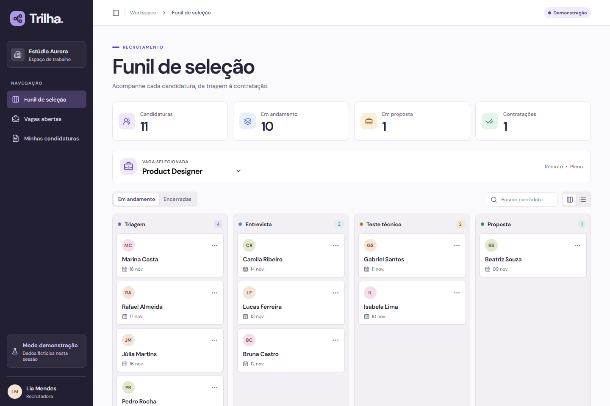

# Trilha · Recruitment platform

[Open the interactive demo](https://trilha-processo-seletivo.vercel.app) · [Português](README.md) · [CI](https://github.com/kaua-chavesvk/processo-seletivo/actions/workflows/ci.yml)

Recruiters review applications on a job-specific board. Candidates submit a PDF résumé and track the same application through its stage history. The project pairs React, TypeScript and TanStack Query with Java 21, Spring Boot, Flyway and PostgreSQL.

[Watch the recruiter and candidate walkthrough](docs/demonstracao.webm)

**Try it in a minute.** Open Marina Costa’s card in **Funil de seleção**, select **Entrevista**, then click **Salvar etapa**. Open **Minhas candidaturas** to see the change from the candidate’s perspective. The public demo runs in Portuguese with fictional data in browser memory. Reload to reset it.

**Run the integrated application.** Start `docker compose up --build -d` and open the [local application](http://localhost:8080). A new database starts empty. The [operations guide](docs/operacao.md) covers creating an administrator, onboarding a recruiter and publishing the first job. The [Swagger UI](http://localhost:8080/swagger-ui.html) exposes the development API.

**Design decisions.** Spring serves the built frontend and REST endpoints on the same origin. The frontend keeps tokens in memory, so reloading requires signing in again. The backend scopes recruitment data to each company, locks an application before a stage change and commits the history entry in the same transaction. Docker volumes persist PDFs and database records. A private S3-compatible bucket can hold résumés when the API runs on ephemeral disks. See the [security report](docs/SEGURANCA.md) for deployment requirements and the two version-specific Spring MVC advisories.

**Verification.** Run `./mvnw verify` with Docker available for the Java suite. Run `python scripts/demonstrar.py` for an isolated HTTP workflow. The CI pipeline also tests the public demo interactions and a real candidate-to-recruiter handoff in Chromium.
