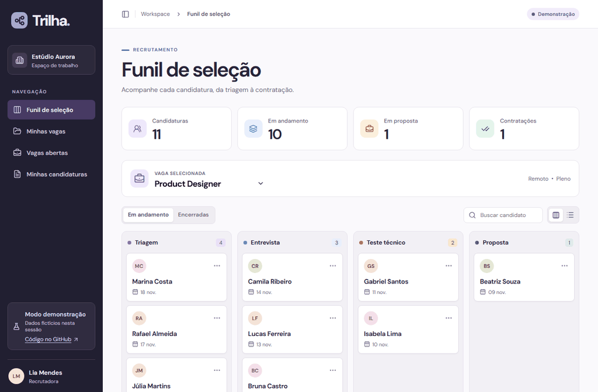

# Trilha

How does a candidate find out what happened after sending a résumé? In Trilha, a recruiter moves an application on the job board. The candidate then sees the new stage and the recruiter’s note in their timeline. Both changes commit in a single database transaction.

**[Try the demo without an account](https://trilha-processo-seletivo.vercel.app)** · [Live app with login](https://trilha-selecao-app.vercel.app) · [Português](README.md)



## My decisions

| What I chose | Benefit and cost |
| --- | --- |
| Lock the application row during a stage change. | When two recruiters act at once, the second waits and the API checks their request against the updated stage. The wait is local to that application. |
| Keep tokens in tab memory. | Credentials stay out of persistent browser storage. Reloading requires a new login, and concurrent requests must coordinate token renewal. |
| Run the demo on fictional data in memory. | A reviewer can try both roles without uploading a résumé. The demo shares the live app’s screens and resets on reload. |

Reviewing the funnel taught me that a test can cover every combination and still reproduce a mistake in the implementation. I wrote down the expected transitions independently. With more time, I would watch recruiters use the mobile board to find out whether the stage filter makes screening faster. [Stage rules](src/main/java/br/dev/selecao/candidatura/Funil.java) · [Domain test](src/test/java/br/dev/selecao/DominioTest.java)

## Run locally

From the repository root, with Docker Compose installed, run the following command.

```sh
docker compose up --build -d
```

Open the [local interface](http://localhost:8080). The database starts empty. The operations guide explains how to create a recruiter and publish the first vacancy. [Operations guide in Portuguese](docs/operacao.md)

## Authorship and tools

Git credits **kaua-chavesvk** with the project changes from the Spring Boot API through the React interface. The wrapper comes from Apache Maven, and MapStruct generates the mapper implementations. For this revision, Codex wrote refactorings, tests and documentation and captured the GIF from the demo. Earlier commits record the changes without a per-file account of assistant use. [Commit history](https://github.com/kaua-chavesvk/processo-seletivo/commits/main/) · [CI runs](https://github.com/kaua-chavesvk/processo-seletivo/actions/workflows/ci.yml) · [Security report in Portuguese](docs/SEGURANCA.md)
