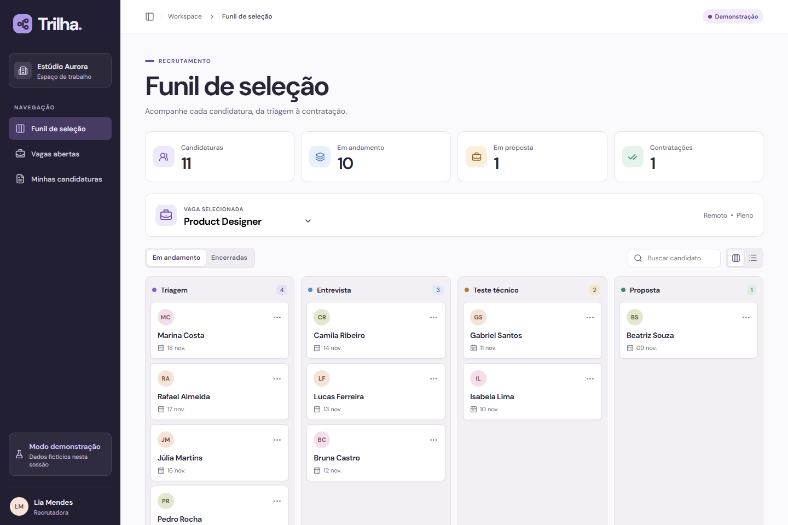
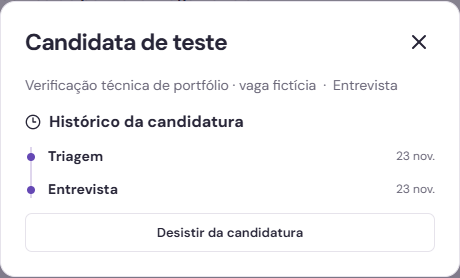
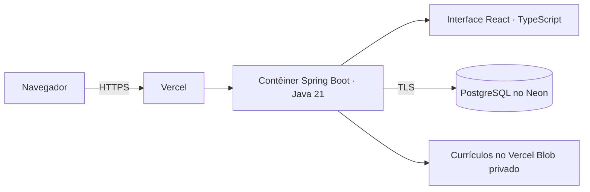

# Trilha · Processo seletivo

[](https://github.com/kaua-chavesvk/processo-seletivo/actions/workflows/ci.yml) · [English](README.en.md)

Uma candidatura começa com um PDF e passa por várias pessoas. O Trilha dá ao recrutador um quadro por vaga e ao candidato um histórico das decisões sobre sua inscrição. Mover um cartão para **Entrevista** atualiza as duas visões do mesmo processo.

**[Experimentar o funil sem cadastro](https://trilha-processo-seletivo.vercel.app)** · **[Abrir a aplicação com login](https://trilha-selecao-app.vercel.app)** · [Assistir ao vídeo do fluxo](docs/demonstracao.webm)



## Um minuto no projeto

1. Na demonstração, abra **Marina Costa** em **Triagem**, escolha **Entrevista** e escreva uma orientação, por exemplo, “Leve um projeto para a conversa”. Clique em **Salvar etapa**. No celular, o funil abre em lista e permite filtrar por etapa. No desktop, também dá para arrastar o cartão entre colunas.
2. Clique em **Ver como Marina acompanha essa mudança**. O histórico da candidata mostra a entrevista e a orientação que você acabou de escrever.
3. Abra a [vaga fictícia de Analista de Dados](https://trilha-processo-seletivo.vercel.app/#vagas/dados). Use **Copiar link da vaga** para abrir a mesma oportunidade em outra aba ou **Simular candidatura** para experimentar a inscrição. Recarregar a demonstração restaura os dados fictícios.

A aplicação com login usa o PostgreSQL e o armazenamento privado de PDFs. A lista pública reflete as vagas que um recrutador publicou. As inscrições e os arquivos enviados por esse endereço persistem entre sessões.

## O que acontece quando uma etapa muda

O React envia a nova etapa para a API. O serviço identifica o recrutador, verifica a empresa da vaga e bloqueia a linha da candidatura no PostgreSQL. Uma máquina de estados em Java decide se a transição é válida. A atualização e o registro do histórico compartilham a mesma transação. Assim, duas pessoas trabalhando no mesmo cartão não conseguem registrar etapas incompatíveis.

| Decisão | Efeito no produto |
| --- | --- |
| Autorização por perfil e empresa | O administrador vincula recrutadores a empresas. Cada recrutador publica e acompanha as vagas da sua empresa. Cada candidato consulta as próprias inscrições. |
| Tokens mantidos na memória da aba | A autenticação é renovada enquanto a aba está aberta. Recarregar exige um novo login. A API e a interface usam a mesma origem. |
| Currículo entregue pela API | O recrutador só recebe o PDF depois da verificação de acesso. Na versão publicada, o envio aceita até 4 MiB e o Blob é privado. |
| Demonstração independente | Quem avalia o portfólio pode mudar etapas e simular inscrições sem compartilhar dados pessoais ou alterar o banco da aplicação. |

<details>
<summary>Ver o histórico de uma candidatura na aplicação publicada</summary>

A captura veio de um teste com duas contas fictícias, um PDF de exemplo e uma mudança de etapa na API publicada.



</details>

## Arquitetura publicada

A aplicação integrada e a demonstração têm projetos próprios na Vercel. Ambos acompanham a branch `main` deste repositório.



Vite compila a interface, TanStack Query consulta a API e o Flyway aplica as migrações com uma conta separada da conta de execução. No Docker local, os currículos ficam em volume. A API também oferece um adaptador para buckets compatíveis com S3. [Guia de operação](docs/operacao.md)

## Executar e verificar

```sh
docker compose up --build -d
```

Abra a [interface local](http://localhost:8080). Para cadastrar a primeira empresa e publicar uma vaga, siga o [guia de operação](docs/operacao.md). Para percorrer o processo em uma instalação Docker descartável, execute `python scripts/demonstrar.py`.

A CI testa o domínio e a autorização com JUnit e PostgreSQL via Testcontainers. O Playwright exercita o quadro em desktop, a candidatura em tela pequena e a passagem de uma candidatura entre duas sessões de navegador. O relatório de segurança documenta os controles, seus limites e os dois avisos de Spring MVC acompanhados pelo projeto. [Execuções da CI](https://github.com/kaua-chavesvk/processo-seletivo/actions/workflows/ci.yml) · [Relatório de segurança](docs/SEGURANCA.md)

## Código para explorar

- A máquina de estados e a transação de mudança de etapa estão em [Funil.java](src/main/java/br/dev/selecao/candidatura/Funil.java) e [CandidaturasService.java](src/main/java/br/dev/selecao/candidatura/CandidaturasService.java).
- O quadro e as operações administrativas da interface estão em [Board.tsx](frontend/src/Board.tsx) e [Operacao.tsx](frontend/src/Operacao.tsx).
- O teste que cruza as visões de candidato e recrutador está em [integrado.spec.ts](frontend/tests/integrado.spec.ts).
