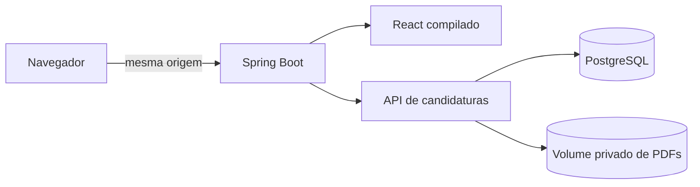

# Trilha · Plataforma de processo seletivo

[](https://github.com/kaua-chavesvk/processo-seletivo/actions/workflows/ci.yml) · [English](README.en.md)

O recrutador acompanha as pessoas em um quadro por vaga. O candidato se inscreve com um currículo em PDF e consulta o histórico de cada etapa. A interface usa React e TypeScript, a API usa Java 21 e Spring Boot e os dados ficam no PostgreSQL.

**[Experimentar a demonstração na Vercel](https://trilha-processo-seletivo.vercel.app)**

Abra o cartão de Marina Costa e avance para entrevista. Em **Minhas candidaturas**, confira a mesma mudança pela perspectiva da candidata. A demonstração usa dados fictícios em memória e reinicia quando você recarrega a página. Para experimentar autenticação e arquivos reais, execute a aplicação com Docker.

[Assistir ao fluxo do recrutador e da candidata](docs/demonstracao.webm)


## Executar com Docker

```sh
docker compose up --build -d
```

Abra a [interface local](http://localhost:8080) ou o [Swagger](http://localhost:8080/swagger-ui.html). Uma instalação nova começa com a lista de vagas vazia. O guia de operação mostra como criar o primeiro administrador, vincular um recrutador à empresa e publicar uma vaga. [Guia de operação](docs/operacao.md)

## Arquitetura e decisões



- **Sessão no navegador.** Access e refresh tokens ficam na memória da aba. Recarregar a página exige novo login. A API valida perfil e empresa em cada operação. React recebe os dados pela mesma origem e o ambiente Vite local encaminha as rotas da API.
- **Mudanças simultâneas.** O serviço bloqueia a candidatura ao alterar uma etapa e grava o histórico na mesma transação. A máquina de estados em Java também protege o fluxo quando outro cliente usa a API diretamente.
- **Persistência.** Repositórios Spring Data concentram listagens, filtros e projeções do painel. O EntityManager compartilhado atende inserções e leituras com bloqueio explícito. No Compose, os volumes preservam banco e arquivos entre reinícios. Para um host com disco efêmero, a API pode usar um bucket privado compatível com S3. O download passa pela mesma autorização nos dois modos.
- **Segurança.** A CI consulta o OSV e o npm. Dois avisos em Spring MVC têm exceções de versão com data de revisão. As condições descritas pelo fornecedor envolvem recursos de renderização que a aplicação atual não utiliza. [Relatório e limitações](docs/SEGURANCA.md)

## Verificar os fluxos

| Comando | O que verifica |
| --- | --- |
| `./mvnw verify` | Domínio, autorização, autenticação e transações com PostgreSQL via Testcontainers. No Windows, use `.\mvnw.cmd verify`. |
| `python scripts/demonstrar.py` | Cria uma instalação Docker descartável, publica uma vaga, envia e baixa um PDF e confere o histórico por HTTP. |
| `npm ci`, `npx playwright install chromium`, `npm test` em `frontend/` | Exercita o quadro, a busca e a candidatura fictícia em tela de celular. A CI também percorre os perfis reais em dois contextos de navegador. |

Para trabalhar só na interface, rode `npm run dev:demo` em `frontend/`. Use `npm run dev` para trabalhar com a API local em execução. As configurações de ambiente, permissões do banco e migrações estão no [guia de operação](docs/operacao.md).
